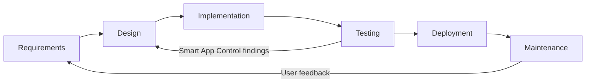
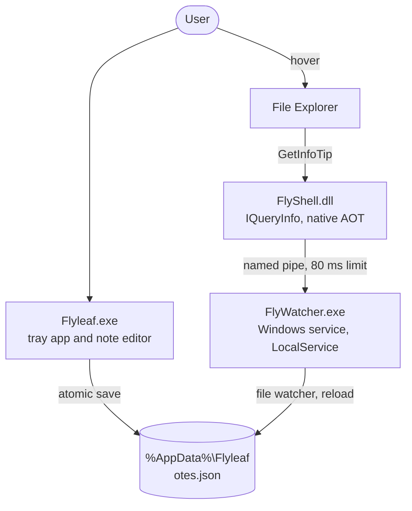
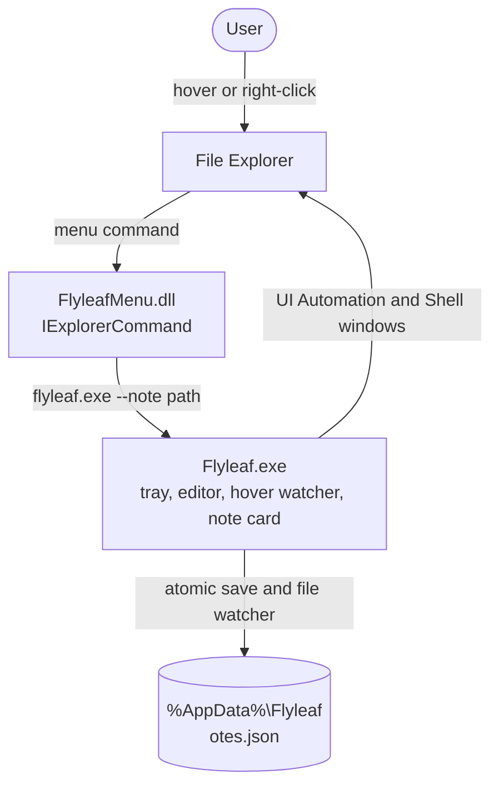
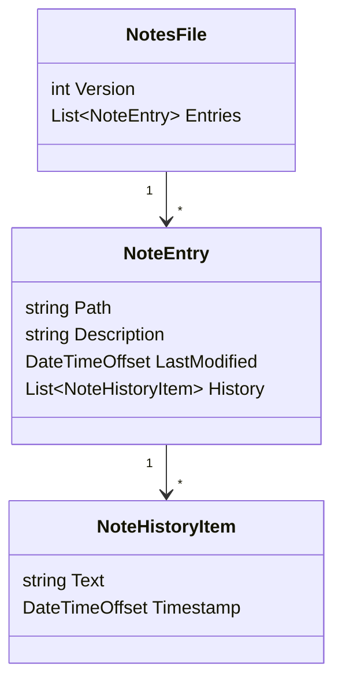
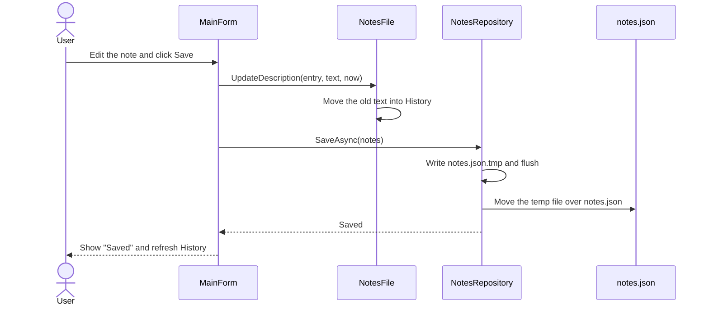
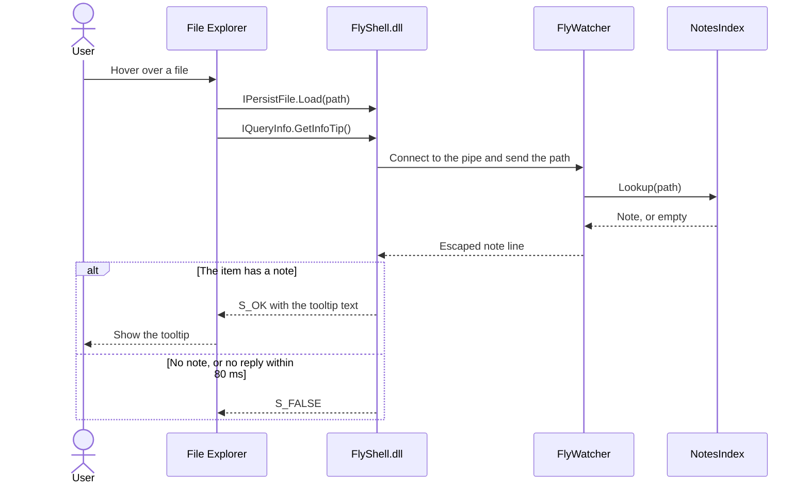
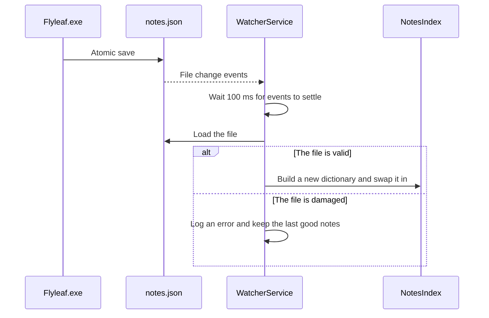
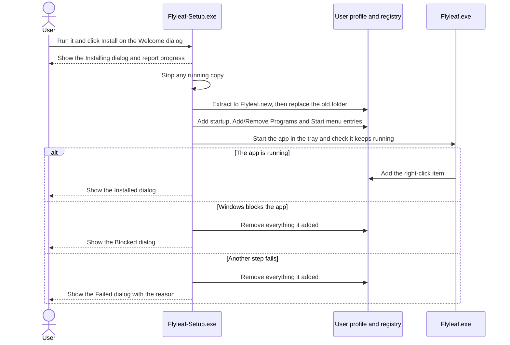
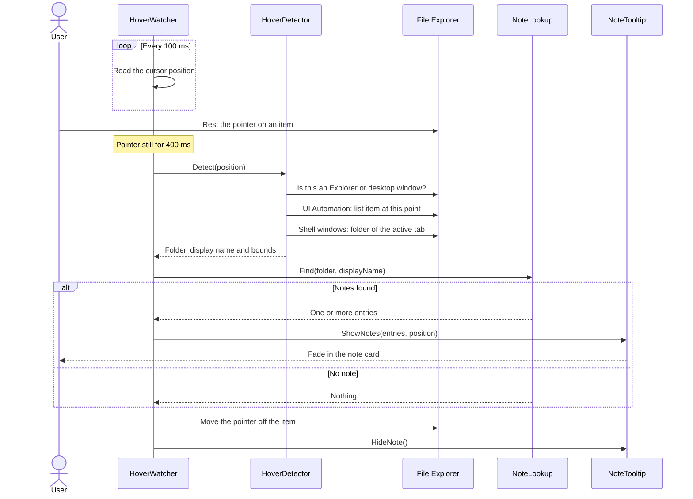
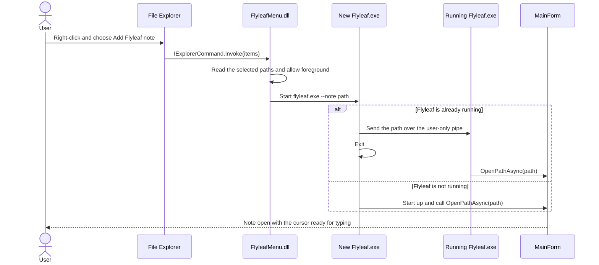

# Flyleaf Technical Documentation

*A note on every file.*

| | |
|---|---|
| **Product** | Flyleaf, a Windows utility that attaches text notes to files and folders |
| **Version** | 1.0.0 (pre-release, Git tag `ver1.0.0`) |
| **Platform** | 64-bit Windows, .NET 10 |
| **Last updated** | 7 November 2026 |

**Contents:** [Overview](#1-overview) · [SDLC summary](#2-sdlc-summary) · [Requirements](#3-requirements) · [Design](#4-design) · [Sequence diagrams](#5-sequence-diagrams) · [Implementation](#6-implementation) · [Testing](#7-testing) · [Deployment](#8-deployment) · [Maintenance](#9-maintenance) · [Risks](#10-risks-and-limitations) · [Decision log](#11-decision-log)

---

## 1. Overview

Flyleaf lets a user attach a note to any file or folder. Resting the pointer on that item in File Explorer shows the note, with no need to open the file.

The project contains two editions. They share the same note editor, data model and `notes.json` file.

| | Classic edition | Store edition |
|---|---|---|
| **Parts** | Tray app, Windows service, Explorer DLL | One tray app, plus a menu DLL in the package |
| **Tooltip** | Native Explorer tooltip | Flyleaf's own note card |
| **Admin rights** | Required to install | Not required |
| **Distribution** | Source only, no longer packaged | `Flyleaf-Setup.exe` (per user), or a Microsoft Store package (`Flyleaf.msix`) |
| **Signing** | Needs your own trusted certificate | Setup: your own certificate. Store: signed when published |
| **Status** | Retained in source | Current direction |

The "Store edition" is the same app however it's installed. Only the Store package gets the main-menu item, because that needs a package identity.

### Current status

| Area | Status |
|---|---|
| Note editor, lists, history, missing-path highlighting | Working |
| Store edition hover detection and note card in real File Explorer | Working (light theme) |
| `Flyleaf-Setup.exe` with the designed dialogs | Working: confirmed in a manual test on a PC with Smart App Control off. Smart App Control blocked this build on a PC with it on |
| Right-click item when installed by Setup | Working (under **Show more options**) |
| Main-menu DLL | Works when called directly through COM. Not yet seen in a real menu |
| Installed MSIX package | **Not yet tested** |
| Microsoft Store approval | **Not yet submitted** |
| Classic edition | No longer packaged. Its service and tooltip were **never seen installed**, because Smart App Control blocked them |

---

## 2. SDLC summary

The project followed an iterative model. Each phase below ran more than once, because testing on a real PC changed the design.



| Phase | Output | Where |
|---|---|---|
| Requirements | Functional and non-functional requirements | [Section 3](#3-requirements) |
| Design | Architecture, data model, pipe contract, security model | [Sections 4–5](#4-design) |
| Implementation | Five source projects and a test project | [Section 6](#6-implementation) |
| Testing | Automated tests and real Explorer checks | [Section 7](#7-testing) |
| Deployment | Single-file setup and MSIX package | [Section 8](#8-deployment) |
| Maintenance | Diagnostics, updates and known issues | [Section 9](#9-maintenance) |

The largest design change came from testing. Smart App Control blocked the unsigned service, which led to the Store edition with fewer parts and no admin rights.

---

## 3. Requirements

### Functional

| ID | Requirement | Classic | Store |
|---|---|---|---|
| FR-1 | Attach a text note to any file or folder | Yes | Yes |
| FR-2 | Show the note when hovering over the item in File Explorer | Built, not seen in Explorer | Yes |
| FR-3 | Keep a timestamped history of earlier notes | Yes | Yes |
| FR-4 | Add items by drag-and-drop or Browse | Built, not tested by hand | Built, not tested by hand |
| FR-5 | Highlight paths that no longer exist in red with "path missing" | Yes | Yes |
| FR-6 | Run from the system tray with no window at sign-in | Yes | Built, needs an installed package to confirm |
| FR-7 | Format notes as bullet lists | Yes | Yes |
| FR-8 | Open a note directly from the right-click menu | No | Yes |

### Non-functional

| ID | Requirement | Result |
|---|---|---|
| NFR-1 | Never write any file next to the user's files | Met by design |
| NFR-2 | No external database, with all data in one readable JSON file | Met |
| NFR-3 | Store only the path and note, never file contents | Met |
| NFR-4 | Lookup in under 1 ms (Classic service) | Met in tests with 10,000 notes |
| NFR-5 | Explorer tooltip gives up after 80 ms (Classic DLL) | Measured at 84–100 ms with the service stopped, slightly over the target |
| NFR-6 | Never lose notes because of a damaged or locked file | Atomic saves, and damaged files are moved aside |
| NFR-7 | Nothing leaves the PC | Met: no network code in any component |

---

## 4. Design

### 4.1 Classic edition architecture



### 4.2 Store edition architecture



### 4.3 Data model

All data lives in `%AppData%\Flyleaf\notes.json`. The file is indented, human-readable UTF-8.

```json
{
  "version": 1,
  "entries": [
    {
      "path": "D:\\Projects\\Apollo\\release plan.docx",
      "description": "Final plan for the November release.",
      "lastModified": "2026-11-05T10:00:00+00:00",
      "history": [
        { "text": "Draft for team review.", "timestamp": "2026-10-28T09:00:00+00:00" }
      ]
    }
  ]
}
```



**Path normalisation.** Every lookup key is absolute, lowercase and backslash-separated, with no trailing separator except on a drive root. `\\?\` prefixes are removed. See `PathNormalizer.cs`.

### 4.4 Pipe contract (Classic edition)

| Direction | Content | Encoding |
|---|---|---|
| Client to server | Absolute path, then `\n` | UTF-8 |
| Server to client | Note, then `\n` (an empty line means no note) | UTF-8 |

- **Pipe name:** `\\.\pipe\FlyWatcherPipe`
- **Escaping:** inside a line, `\` is written as `\\`, and line breaks as `\n` and `\r`. This keeps a multi-line note on one line.
- **Limits:** 80 ms on the client, 1 second per client on the server, 256 KB per line, 8 simultaneous connections.

### 4.5 Security design

| Concern | Decision |
|---|---|
| Service privileges | Runs as `LocalService`, with read access only to the notes folder |
| Who can read notes over the pipe | Only the installing user's SID |
| Impersonation | The DLL connects anonymously, so the service can't act as the user |
| Elevation | Setup needs none: it writes only to the user's own profile and registry |
| Planted DLLs | Setup restricts DLL loading to System32 at startup |
| Failed install | Setup removes everything it added, and an upgrade extracts beside the current copy first |
| Second-launch channel (Store) | Pipe limited to the current user with `PipeOptions.CurrentUserOnly` |
| Hover data | Compared with local notes only, and never stored or sent |

---

## 5. Sequence diagrams

### 5.1 Saving a note



### 5.2 Classic edition: showing a tooltip



### 5.3 Classic edition: reloading after a save



### 5.4 Installing with Setup



### 5.5 Store edition: hovering over an item



### 5.6 Store edition: Add Flyleaf note from the right-click menu



---

## 6. Implementation

### 6.1 Technology

| Area | Choice |
|---|---|
| Language and runtime | C# on .NET 10 LTS |
| User interface | Windows Forms |
| JSON | `System.Text.Json` with source generation |
| Native components | Native AOT with `GeneratedComInterface` |
| Service host | `Microsoft.Extensions.Hosting.WindowsServices` |
| Tests | xUnit (test project only) |

### 6.2 Projects

| Project | Output | Purpose |
|---|---|---|
| `src/Flyleaf.Core` | Library | Models, path rules, `notes.json` access, pipe protocol, lookup, list formatting |
| `src/Flyleaf` | `Flyleaf.exe` | Classic tray app. Owns the shared `MainForm` and tray code |
| `src/FlyWatcher` | `FlyWatcher.exe` | Classic service: index, file watcher, pipe server |
| `src/FlyShell` | `FlyShell.dll` | Classic Explorer tooltip handler |
| `src/FlySetup` | `Flyleaf-Setup.exe` | Per-user installer for the Store edition app with designed dialogs, also built without files as the uninstaller. `--silent` shows no dialogs, and `--preview <screen>` shows one dialog and changes nothing |
| `src/FlyleafStore` | `Flyleaf.exe` | Store edition: hover detection, note card, single-instance channel |
| `src/FlyleafMenu` | `FlyleafMenu.dll` | Store edition main-menu command |
| `tests/Flyleaf.Tests` | Test assembly | Unit and end-to-end tests |
| `installer/` | Scripts | Build scripts, icon generator, test-install script |

### 6.3 Coding standards

- `async`/`await` with cancellation tokens throughout, with blocking only at the synchronous COM boundary, bounded by a timeout.
- XML documentation comments on public types and members.
- File access wrapped so that a missing or locked file never crashes the app.
- Exceptions never escape into Explorer from a shell component.

---

## 7. Testing

### 7.1 Automated tests

Run with `dotnet test tests/Flyleaf.Tests/Flyleaf.Tests.csproj -c Release`.

| Group | Tests | Latest result on this PC |
|---|---|---|
| Path rules, pipe escaping, note model, repository, lookup, list formatting | 40 | Passed |
| Real Explorer hover detection (runs only with `FLYLEAF_UI_TESTS=1`) | 1 | Skipped in the latest run. Passed when last run on request, before the tooltip and menu changes |
| Classic service index and pipe tests, and `FlyShell.dll` | 9 | **Not run on current builds:** Smart App Control blocks `FlyWatcher.dll`, and Setup no longer builds `FlyShell.dll`. All passed in earlier builds |

### 7.2 Real-world checks

These ran on Windows 11 with Smart App Control on, using temporary notes files.

| Check | Result |
|---|---|
| Hover on a noted file, a noted folder and a file with no note | Passed |
| Hidden extensions, and two files that share a name | Passed: separate labelled sections |
| Note card with bullets and wrapped lines | Passed in the light theme |
| Typing a list: Enter continues it, Enter on an empty bullet ends it | Passed |
| Save, with the old text moving to History | Passed |
| Right-click verb opening the note in the running copy | Passed |
| `FlyleafMenu.dll` title, icon and command through COM | Passed |
| Setup silent install: files, shortcut, startup and Add/Remove entries | Passed |
| Hover and right-click item from the installed copy | Passed |
| Start at sign-in (`--tray`) opens no window | Passed |
| Uninstall removes everything and keeps real notes | Passed |
| Final Setup with the designed dialogs, on a PC with Smart App Control off | Passed in a manual test |

### 7.3 Still to test

- Installing and starting the MSIX, including start at sign-in.
- The item in Windows 11's main right-click menu, and its icon.
- Tab, Enter and Esc in the Setup dialogs.
- Setup's Blocked and Failed dialogs when reached for real, rather than in preview.
- Screen readers: buttons and the check box are real controls, but the dialogs' other text is painted, so screen readers don't read it.
- The dark theme, desktop hover and multiple Explorer tabs.
- Drag-and-drop, Browse and the tray menu by hand.

---

## 8. Deployment

### 8.1 Build

| Output | Command |
|---|---|
| Setup: `dist\Flyleaf-Setup.exe` | `powershell -ExecutionPolicy Bypass -File installer/build.ps1` |
| Setup, signed | Add `-CertThumbprint YOUR_THUMBPRINT` |
| Store: `dist\store\Flyleaf.msix` | `powershell -ExecutionPolicy Bypass -File installer/build-store.ps1` |

Building needs the .NET 10 SDK and the Visual Studio C++ build tools. Build output isn't stored in Git.

### 8.2 Publishing to the Microsoft Store

1. Create a Partner Center account and reserve the app name.
2. Copy the three values under **Product identity**, then build with them:

   ```bash
   powershell -ExecutionPolicy Bypass -File installer/build-store.ps1 -IdentityName "VALUE" -Publisher "CN=VALUE" -PublisherDisplayName "VALUE"
   ```

3. Upload `Flyleaf.msix`, and add a description, screenshots and a privacy policy.
4. Explain the restricted capabilities in the submission notes:
   - `runFullTrust`: Flyleaf is a desktop tray app that reads the item under the cursor in File Explorer.
   - `unvirtualizedResources`: notes stay in `%AppData%\Flyleaf`, so they're easy to back up and survive an uninstall.

### 8.3 Testing a package before the Store

`installer/test-install-package.ps1` signs the package with a temporary self-signed certificate and installs it. Trusting that certificate is a machine-wide security change, so Windows asks for approval. `-Remove` undoes it. This script has not been run yet.

---

## 9. Maintenance

| Task | How |
|---|---|
| Back up notes | Copy `%AppData%\Flyleaf\notes.json` |
| Damaged notes file | The tray app moves it to `notes.corrupt-<date>.json` and starts empty |
| Classic service logs | Windows Event Viewer, Application log, source `Flyleaf` |
| Code-integrity blocks | Event Viewer, `Microsoft-Windows-CodeIntegrity/Operational`, events 3033 and 3077 |
| Certificate renewal (Classic) | Certificates now last at most 460 days |
| Remove a trial right-click item | `Flyleaf.exe --remove-menu` |

---

## 10. Risks and limitations

| Risk | Impact | Mitigation |
|---|---|---|
| Unsigned builds are blocked by Smart App Control | Flyleaf can't run on those PCs | Publish through the Store, or sign with a trusted certificate |
| The Store rejects the app or its capabilities | Delays distribution | Explain each capability, and keep the Classic edition available |
| A Windows update changes how Explorer exposes its window | Store edition hover detection could stop working | Automated Explorer test, and a Classic edition using the official interface |
| Hover detection can't see virtual views | No note in Home, search results or libraries | Documented limit |
| Notes are tied to full paths | Moving or renaming a file breaks the link | "Path missing" highlight in the list |
| Notes are per user and per PC | Colleagues don't see each other's notes | Documented limit. Sharing is a possible future feature |
| The Classic service serves one user | A second user's install takes over the service | Documented limit |
| The name "Flyleaf" may be in use elsewhere | A Store name or search conflict | Check availability when reserving the name |

---

## 11. Decision log

| Decision | Why |
|---|---|
| .NET 10 instead of .NET 8 | .NET 8 support ends on 10 November 2026, and .NET 10 is supported until November 2028 |
| Native AOT instead of SharpShell | Explorer never has to load the .NET runtime, and SharpShell doesn't fit .NET 8 or later |
| `LocalService` instead of `LocalSystem` | Least privilege, with access to only one folder of the profile |
| Pipe restricted to one user's SID | Other accounts on the PC can't read the notes |
| Escaped lines in the pipe protocol | Multi-line notes would otherwise be cut off at the first line |
| File watcher instead of a pipe "changed" signal | Simpler, with no extra message type |
| Custom setup instead of ClickOnce, WiX or NSIS | One double-click file with no extra build tooling |
| Setup installs the one-app version per user | No admin prompt and no service for Windows to block, so peers can install it themselves |
| Setup's dialogs use the Windows API directly | Setup stays a small native program, adding very little to its size, with real controls for buttons and the check box |
| Setup installs a folder, not a single-file app | It matches the tested package layout, and nothing unpacks to a temp folder at run time |
| Added a Store edition | Smart App Control blocks unsigned files whichever language they're written in, and the Store signs packages |
| Own note card in the Store edition | Packaged apps can't load an in-process tooltip handler into Explorer |
| Manifest-based menu command instead of registry verbs | It reaches Windows 11's main menu and is removed on uninstall |
