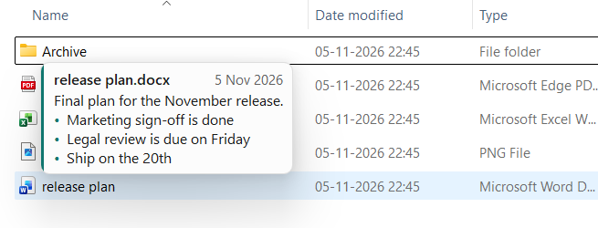
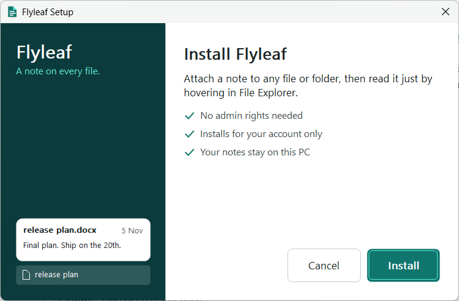
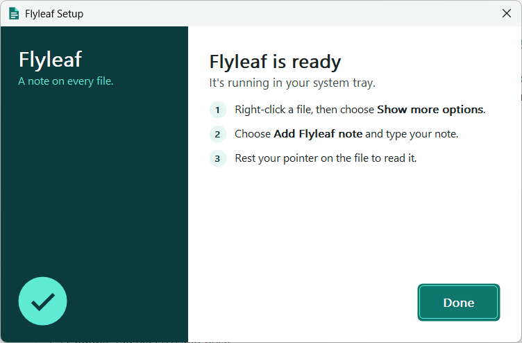
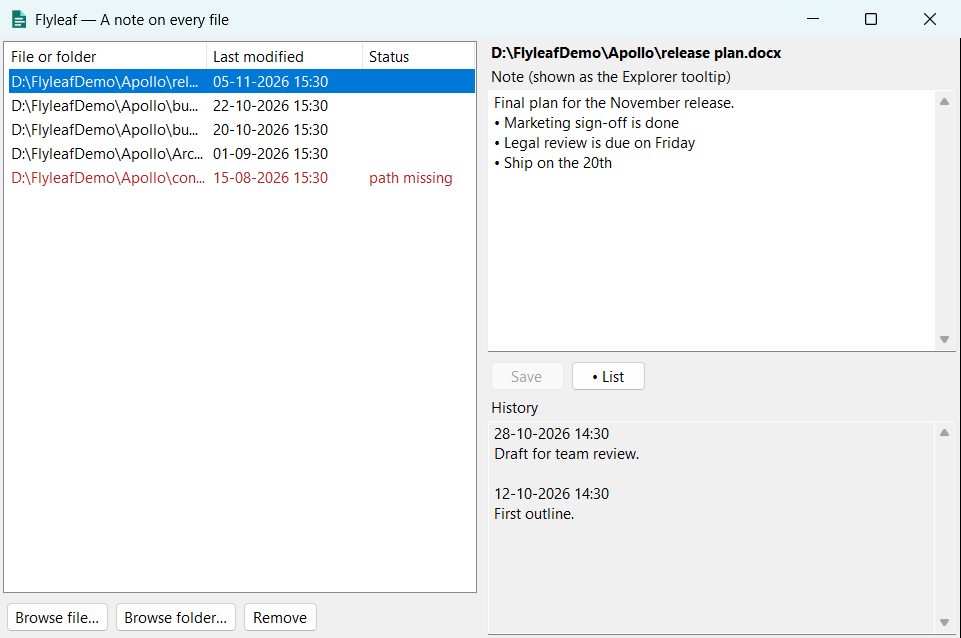
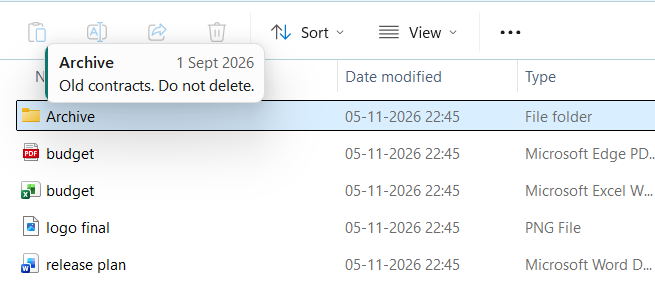
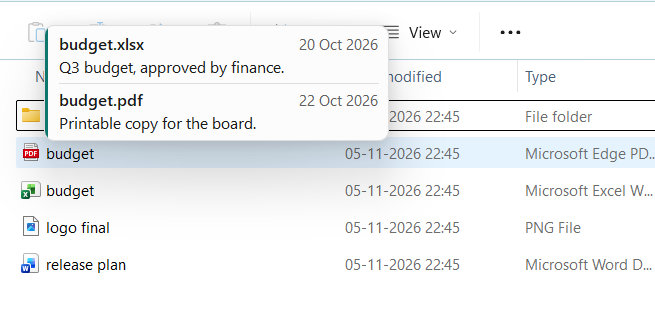

# Flyleaf User Manual

*A note on every file.*

Flyleaf lets you attach a note to any file or folder on your PC. Rest your pointer on the item in File Explorer and the note appears, without opening the file.



## Find your role

Flyleaf has no accounts, logins or permission levels. Everyone who installs it can do everything. These roles describe how different people use it, so start with the one that fits you.

| Your role | You want to | Go to |
|---|---|---|
| **Everyday user** | Write and read notes on your own files | [Everyday user](#everyday-user) |
| **Team lead or project owner** | Keep project files understandable | [Team lead or project owner](#team-lead-or-project-owner) |
| **IT administrator** | Install, support and back up Flyleaf | [IT administrator](#it-administrator) |
| **Developer or maintainer** | Build and release Flyleaf | [Developer or maintainer](#developer-or-maintainer) |

> **Before you start:** Flyleaf is pre-release and isn't in the Microsoft Store yet. To install it, double-click `Flyleaf-Setup.exe` and click **Install**. It needs no admin rights. If Windows shows **"Windows protected your PC"**, see [IT administrator](#smart-app-control-and-smartscreen).



When it finishes, Setup shows how to add your first note. Flyleaf is then running in the system tray.



---

## Everyday user

### The main window



- **Left:** every file and folder that has a note. A red row marked **path missing** means the item has been moved, renamed or deleted.
- **Right:** the note for the selected item, with its earlier versions under **History**.

### Add a note from File Explorer

1. Right-click a file or folder.
2. On Windows 11, choose **Show more options**.
3. Choose **Add Flyleaf note**.
4. Flyleaf opens with the cursor in the note box. Type your note.
5. Click **Save**, or press **Ctrl+S**.

### Add a note from Flyleaf

1. Open Flyleaf from the Start menu, or by clicking its icon in the system tray.
2. Drag a file or folder onto the window, or click **Browse file…** or **Browse folder…**.
3. Type your note, then click **Save**.

### Read a note

Rest your pointer on the file or folder in File Explorer for about half a second. The note card shows the file name, the date the note was last updated, and the note. Move the pointer away and the card disappears.



Flyleaf must be running in the tray for notes to appear.

### Make a list

1. Click **• List** to turn the current line, or the selected lines, into bullets. Click it again to remove them.
2. Press **Enter** to start the next bullet.
3. Press **Enter** on an empty bullet to end the list.

### Change or remove a note

| To | Do this |
|---|---|
| **Change a note** | Select the item, edit the text and click **Save**. The old text moves to **History**. |
| **See earlier versions** | Select the item and look under **History**. |
| **Remove a note** | Select the item, click **Remove**, then confirm. This deletes the note and its history. Your file isn't touched. |

### Open and close Flyleaf

- **Close the window:** the **X** only hides the window. Flyleaf keeps running, and notes keep appearing.
- **Reopen it:** click the tray icon.
- **Quit fully:** right-click the tray icon and choose **Exit**. Notes stop appearing until you start Flyleaf again.

### When two files share a name

If Windows hides file extensions, `budget.xlsx` and `budget.pdf` both appear as `budget`. Flyleaf can't tell which one you're pointing at, so it shows a labelled section for each note it finds on a file with that name.



To avoid this, turn on file extensions in File Explorer under **View > Show > File name extensions**. Flyleaf then knows exactly which file you mean.

### Where notes don't appear

Notes only appear in normal folder views and on the desktop. They don't appear in:

- Home and Recent
- Search results
- Libraries, Gallery and other virtual views

Open the file's actual folder to see its note.

---

## Team lead or project owner

Flyleaf is useful for making a project folder explain itself, with notes like these:

| On | Example note |
|---|---|
| A folder | "Signed contracts only. Ask Legal before deleting." |
| A file | "Final plan. Supersedes the October version." |
| A template | "Copy this, don't edit it." |

### What to know before relying on it

- **Notes are personal.** They're stored on each person's PC, under their Windows account. **Your colleagues won't see your notes**, even on a shared drive.
- **Notes follow the path, not the file.** If a file is moved or renamed, Flyleaf shows it as **path missing**. Use this to spot reorganised files.
- **Moved files need a new note.** Add the item again at its new location, then remove the old row.

### Sharing notes by hand

There's no sharing feature yet. You can give someone a copy of your notes, but this **replaces all of their notes**, so only do it for someone who has none:

1. Ask them to exit Flyleaf from the tray.
2. Send them your `notes.json`, which is at `%AppData%\Flyleaf\notes.json`.
3. They put it in the same place on their PC and start Flyleaf.

Notes only match where the file paths are identical on both PCs, such as the same drive letter and folders.

---

## IT administrator

### Installing

`Flyleaf-Setup.exe` installs for the current user only and needs no admin rights, so each person on a PC installs their own copy. Add `--silent` for a scripted install with no prompts.

A Microsoft Store listing is planned. It would add the item to Windows 11's main right-click menu.

### Smart App Control and SmartScreen

Current builds are unsigned, so Windows may stop them:

| What you see | What it means | What to do |
|---|---|---|
| **"An Application Control policy has blocked this file"** | Smart App Control blocked an unsigned file | Use a signed or Store build. We don't recommend turning Smart App Control off, because turning it back on may not be possible without resetting Windows. |
| **"Windows protected your PC"** | SmartScreen doesn't recognise the file | Confirm where the file came from, then choose **More info > Run anyway**. |
| **Setup shows "Windows blocked Flyleaf"** | Setup installed the app, Windows blocked it, and Setup removed it | Use a signed copy. No clean-up is needed. |

### What Flyleaf changes on a PC

Everything is per user. Setup changes nothing machine-wide.

| Item | Location |
|---|---|
| Notes | `%AppData%\Flyleaf\notes.json` |
| Program files | `%LocalAppData%\Programs\Flyleaf` |
| Start menu shortcut | Current user's Start menu |
| Startup entry | `HKCU\Software\Microsoft\Windows\CurrentVersion\Run` |
| Right-click item | `HKCU\Software\Classes`, for all files and folders |
| Add/Remove Programs entry | Current user |

### Privacy

Flyleaf has no network code, so notes and file paths stay on the PC. To check what's under the pointer, Flyleaf reads the item's name from File Explorer and compares it with the local notes. It doesn't store or send that name.

### Back up and restore

1. **Back up:** copy `%AppData%\Flyleaf\notes.json`. Flyleaf doesn't need to be closed.
2. **Restore:** exit Flyleaf, put the file back, then start Flyleaf.

If `notes.json` is ever damaged, Flyleaf keeps it as `notes.corrupt-<date>.json` in the same folder and starts with an empty list. The file is plain text, so you can often repair it by hand.

### Troubleshooting

| Problem | Check |
|---|---|
| No note appears | Is Flyleaf running in the tray? Are you in a normal folder view? Does the note have text? |
| Note appears for the wrong file | Turn on file extensions, as two files may share a name. |
| Row is red with **path missing** | The item moved, or its drive or network share isn't connected. |
| Right-click item is missing | On Windows 11, look under **Show more options**. The item is added when Flyleaf first starts. |
| Something was blocked | Check Event Viewer under `Microsoft-Windows-CodeIntegrity/Operational` for events 3033 and 3077. |

### Uninstall

1. Go to **Settings > Apps > Installed apps > Flyleaf > Uninstall**.
2. Leave **Also delete my notes** off to keep your notes, or turn it on to delete them permanently.
3. Click **Remove**, or **Keep Flyleaf** to change your mind.

If you keep your notes and install Flyleaf again, it picks them up automatically.

---

## Developer or maintainer

Full details are in the [Technical Documentation](Technical-Documentation.md). In brief:

1. Install the .NET 10 SDK and the Visual Studio C++ build tools.
2. Build Setup, the file to share with others:

   ```bash
   powershell -ExecutionPolicy Bypass -File installer/build.ps1
   ```

   Or build the Store package:

   ```bash
   powershell -ExecutionPolicy Bypass -File installer/build-store.ps1
   ```

3. Run the tests:

   ```bash
   dotnet test tests/Flyleaf.Tests/Flyleaf.Tests.csproj -c Release
   ```

Automated UI tests set the `FLYLEAF_NOTES_FILE` environment variable so that they never touch real notes.

---

## Quick reference

| Action | How |
|---|---|
| Read a note | Rest the pointer on the item for about half a second |
| Add a note | Right-click the item, **Show more options**, then **Add Flyleaf note** |
| Save | **Ctrl+S** or **Save** |
| Start a list | **• List** |
| Next bullet | **Enter** |
| End a list | **Enter** on an empty bullet |
| Open Flyleaf | Click the tray icon |
| Quit Flyleaf | Right-click the tray icon, then **Exit** |
| Notes file | `%AppData%\Flyleaf\notes.json` |
