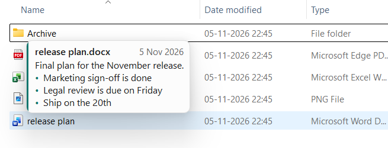
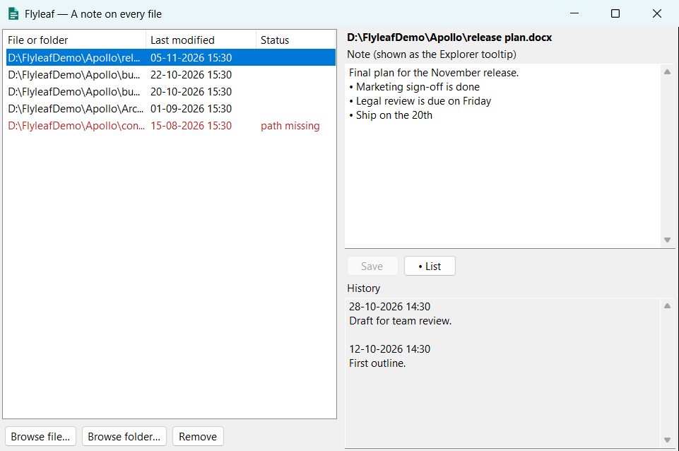

<p align="center">
  
</p>

<h1 align="center">Flyleaf</h1>

<p align="center"><strong>A note on every file.</strong></p>

<p align="center">
  Hover over any file or folder in Windows File Explorer and read its note, without opening it.
</p>

<p align="center">
  
  
  
  <a href="LICENSE"></a>
</p>

<p align="center">
  
</p>

## Why Flyleaf?

File names only say so much. Which `final_v3` is really final? Why does this folder exist? Can it be deleted? Usually the answer means opening the file or asking someone.

Flyleaf keeps that answer on the file itself, where you can see it the moment you need it.

## Features

- **Notes on hover:** rest the pointer on a file or folder to read its note.
- **Right-click to add:** choose **Add Flyleaf note** and start typing.
- **Change history:** earlier versions of each note are kept with timestamps.
- **Bullet lists:** format notes as lists, with Enter continuing the list.
- **Missing-file detection:** moved or deleted items are highlighted in red.
- **Light and dark themes:** the note card follows your Windows theme.
- **Your files stay untouched:** nothing is ever written next to or into them.
- **Private by design:** there's no account and no network code, so everything stays on your PC.
- **One readable file:** all notes live in `%AppData%\Flyleaf\notes.json`, which is easy to back up.

<p align="center">
  
</p>

## Project status

Flyleaf is **pre-release**, and there's no public download yet.

| Area | Status |
|---|---|
| Note editor, lists and history | Working |
| Hover notes in real File Explorer | Working |
| Right-click item in Windows 11's main menu | Built, needs an installed package to confirm |
| Installed Store package | Not yet tested |
| Microsoft Store listing | Not yet submitted |
| Dark theme | Built, not yet tested |

**Current builds are unsigned**, so Windows Smart App Control can block them, and SmartScreen may show a warning. See [Signing and distribution](#signing-and-distribution).

## Two editions

| | **Store edition** (current direction) | **Classic edition** |
|---|---|---|
| **Parts** | One tray app | Tray app, Windows service, Explorer extension |
| **Tooltip** | Flyleaf's own note card | Native Explorer tooltip |
| **Admin rights** | Not required | Required |
| **Signing** | Done by the Microsoft Store | Needs your own trusted certificate |
| **Package** | `Flyleaf.msix` | `Flyleaf-Setup.exe` |

## Documentation

| Document | For |
|---|---|
| [User Manual](Documentation/User-Manual.md) | Everyday users, team leads, IT administrators and developers |
| [Technical Documentation](Documentation/Technical-Documentation.md) | SDLC, architecture, sequence diagrams, testing and deployment |
| [Marketing Presentation](Documentation/Flyleaf-Marketing-Presentation.pptx) | A short product overview for sharing |

## Build from source

You'll need Windows x64, the [.NET 10 SDK](https://dotnet.microsoft.com/download/dotnet/10.0), and the Visual Studio C++ build tools.

```bash
git clone https://github.com/rakeshnamadi/FlyLeaf.git
```

Build the Store package, which is written to `dist\store\Flyleaf.msix`:

```bash
powershell -ExecutionPolicy Bypass -File installer/build-store.ps1
```

Build the Classic setup, which is written to `dist\Flyleaf-Setup.exe`:

```bash
powershell -ExecutionPolicy Bypass -File installer/build.ps1
```

Run the tests:

```bash
dotnet test tests/Flyleaf.Tests/Flyleaf.Tests.csproj -c Release
```

On a PC with Smart App Control on, some service tests can't load their unsigned code. The [Technical Documentation](Documentation/Technical-Documentation.md#7-testing) has the details.

## Signing and distribution

Windows checks a file's signature and reputation, so rewriting the app wouldn't avoid these checks. There are two ways to distribute it properly:

- **Microsoft Store (recommended):** the Store signs the package when it's published. See the [publishing steps](Documentation/Technical-Documentation.md#82-publishing-to-the-microsoft-store).
- **Your own certificate:** install a certificate from a publicly trusted authority, then build with its thumbprint:

  ```bash
  powershell -ExecutionPolicy Bypass -File installer/build.ps1 -CertThumbprint YOUR_THUMBPRINT
  ```

## Project layout

```
src/Flyleaf.Core    Shared models, path rules, notes.json access, pipe protocol
src/Flyleaf         Classic tray app and the shared note editor
src/FlyWatcher      Classic Windows service
src/FlyShell        Classic Explorer tooltip extension (Native AOT)
src/FlySetup        Classic single-file setup and uninstaller
src/FlyleafStore    Store edition: hover detection and note card
src/FlyleafMenu     Store edition: Windows 11 right-click item (Native AOT)
tests/              Unit and end-to-end tests
installer/          Build scripts and icon generator
Documentation/      Technical documentation, user manual and presentation
```

## Known limitations

- Notes are per user and per PC, so colleagues don't see each other's notes.
- Notes follow the file's path, so moving or renaming a file breaks the link. Flyleaf flags these as **path missing**.
- The Store edition shows no notes in Home, search results or libraries.
- With extensions hidden, files that share a name show a labelled section for each note.

## License

Flyleaf is released under the [MIT License](LICENSE).
